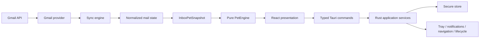

# Architecture

## Shape

React receives normalized non-secret DTOs. Rust owns OAuth, Gmail HTTP, refresh, persistence, native integration, and coordination. The mail domain does not reference pet concepts; the pet domain does not reference providers.

## Runtime rules

- One local process; no backend or server runtime.
- Poll per account on a configurable 30-second healthy baseline. Prevent overlapping polls and add backoff/jitter after errors. Account-row activation and the zero-argument manual check may advance scheduler eligibility to now, but never call the provider concurrently or await the poll before returning navigation/UI acknowledgement. Suspend scheduled polling while macOS sleeps and request one guarded immediate catch-up on wake.
- Persist `lastHistoryId`, `lastSyncAt`, and the bounded set of Gmail message ids currently in the `INBOX + UNREAD` intersection. A first sync obtains `emailAddress/historyId` from `users.getProfile`, paginates `users.messages.list(labelIds=INBOX,q=is:unread)`, and establishes a baseline without creating historical pending mail. Every successful incremental poll uses History only for new-message candidates/cursor and reconciles membership from the same authoritative paginated INBOX query before one atomic CAS commit; Gmail 404 triggers the same bounded full resync.
- Native new-mail delivery starts only from the exact messages inserted by a successful incremental state/cursor commit. The sync result carries those committed normalized metadata records to the application coordinator, which builds a bounded native title/subtitle/body from persisted account email, subject, and sender and plays the bundled sound. UserNotifications receives only an opaque digest; a bounded process-local Rust correlation retains local account UUID plus message id, which are revalidated against durable state before best-effort conversation navigation with one account fallback. Baseline, history recovery, startup hydration, unread-only changes, and failed/duplicate commits never enter this path.
- macOS packaging declares `LSUIElement=true` so LaunchServices treats Zerochi as a menu-bar agent before runtime initialization. Native setup and every restoration path also reassert `ActivationPolicy::Accessory` with Dock visibility disabled; window show/focus never promotes the process to a regular Dock application.
- Google access is limited to OAuth plus Gmail `users.getProfile`, authoritative `users.messages.list(labelIds=INBOX,q=is:unread)` on baseline/recovery/every successful poll, incremental `users.history.list`, and `users.messages.get(format=metadata)` for newly added candidates still present in the authoritative set. Metadata requests name only `From`, `To`, and `Subject`; bodies, snippets, raw/full payloads, and attachments are never requested or persisted. The OAuth grant is exactly `https://www.googleapis.com/auth/gmail.readonly`; account identity comes from `users.getProfile`, not OpenID userinfo.
- Persist non-secret state atomically with schema versioning and corruption recovery. Refresh tokens use a Rust-only `SecureStore` backed by macOS Keychain through `keyring-core` + `apple-native-keyring-store`: Protected Data for signed/provisioned builds and legacy Keychain only for unsigned development. React never receives refresh tokens.
- Sleep pauses polling; wake triggers one guarded sync. When popup is hidden, sprite timers stop. Idle target is effectively zero CPU except scheduled polling.

## Frontend

`src/types` is the shared DTO/port boundary. `src/pet` is pure engine plus renderer. UI folders only compose presentation. No Redux/event-bus/DI framework in V1.

The menu popup uses a frameless transparent native window. React draws the opaque rounded bubble, its centered top pointer, and its shadow inside a transparent safe inset. On macOS, the tray adapter validates the clicked native status window against the immutable click rectangle and positions the popup synchronously in AppKit logical points, clamping to the target screen's visible frame. This avoids scaling a transfer with the previous popup monitor's backing scale. A visible popup transfers on another monitor's tray press and closes on the same monitor's press; deferred blur rechecks actual focus and the current intent generation. Other platforms retain Positioner. The accessible home heading remains in the document even when visually hidden; subview headings remain visible.

## Rust

Provider code lives in `auth/gmail/sync/accounts`; native adapters in `tray/notifications/secure_store/navigation/platform`; Tauri commands translate stable DTOs and do not expose internal credentials.

## Google application configuration

Each developer creates a Google OAuth client of type **Desktop app**. In debug builds, Rust loads `ZEROCHI_GOOGLE_CLIENT_ID` and the matching `ZEROCHI_GOOGLE_CLIENT_SECRET` from the process environment first and then from an ignored local `.env` through `dotenvy`. The Desktop `client_secret` is an extractable public-client credential, not a security boundary. Distributable builds inject both values only through the protected build wrapper. The wrapper accepts a complete process/CI pair first or, for a local release invocation, a complete ignored root `.env` pair; it never mixes sources. Runtime release code does not read dotenv. Neither value may appear in React, logs, fixtures, command DTOs, tracked files, or bundled plaintext configuration. Downloaded Google credential JSON files remain ignored and must not be parsed from or committed to the repository.

Zerochi uses Authorization Code + PKCE as a public installed client. The embedded Desktop client credential is not a security boundary and is expected to be extractable from a distributed app; PKCE verifier/state and exact loopback redirect protect each authorization attempt. Authorization codes and access tokens remain in Rust memory, while each user's refresh token persists only in that user's Keychain. Rotating the shared Desktop credential requires a new signed build.

## Future provider seam

`Gmail → normalized Mail State → InboxPetSnapshot → PetEngine`. A future Outlook adapter stops at the same mail-state boundary and cannot change PetEngine.

## Edge-case policies for later milestones

| Case | Required policy |
|---|---|
| App closed/restarted or Mac sleep/wake | Persist state/cursor; pause asleep; run one guarded catch-up on wake/start. |
| Offline/API outage | Preserve cursor/state, exponential backoff with jitter, reconnect without duplicate notifications. |
| Revoked/invalid token or restricted Workspace | Mark only that account as action-required; never erase other accounts or leak provider details. |
| Expired history cursor | Bounded recovery baseline/full sync; do not convert historical inbox into pending. |
| Duplicate mail or overlapping polls | Unique `(accountId,messageId)` and per-account sync mutex; atomic message/cursor commit. |
| Removed account | Stop jobs, remove normal state, request separate secure-secret deletion, recompute snapshot. |
| Large arrival batch | Paginate/batch metadata, coalesce notifications/pet events, keep UI responsive. |
| Corrupt local state | Version/check/backup, fail closed for credentials, recover without silent pending inflation. |
| Browser has several Google sessions | Navigation adapter owns the uncertainty; never persist `/u/N/` as identity. |
