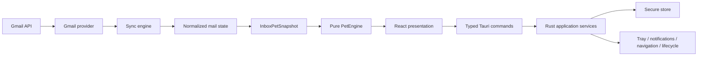

# Architecture

## Shape

React receives normalized non-secret DTOs. Rust owns OAuth, Gmail HTTP, refresh, persistence, native integration, and coordination. The mail domain does not reference pet concepts; the pet domain does not reference providers.

## Runtime rules

- One local process; no backend or server runtime.
- Poll per account on a configurable 30–60 second baseline. Prevent overlapping polls and add backoff/jitter after errors.
- Persist `lastHistoryId` and `lastSyncAt`. A first sync establishes a baseline; valid history fetches deltas; Gmail 404 from an old cursor triggers a bounded recovery/full resync without counting historical mail as newly pending.
- Fetch metadata only (`id`, `threadId`, sender, subject, received time) unless a later requirement changes the contract.
- Persist non-secret state atomically with schema versioning and corruption recovery. Refresh tokens use a Rust-only `SecureStore` backed by macOS Keychain through `keyring-core` + `apple-native-keyring-store`: Protected Data for signed/provisioned builds and legacy Keychain only for unsigned development. React never receives refresh tokens.
- Sleep pauses polling; wake triggers one guarded sync. When popup is hidden, sprite timers stop. Idle target is effectively zero CPU except scheduled polling.

## Frontend

`src/types` is the shared DTO/port boundary. `src/pet` is pure engine plus renderer. UI folders only compose presentation. No Redux/event-bus/DI framework in V1.

## Rust

Provider code lives in `auth/gmail/sync/accounts`; native adapters in `tray/notifications/secure_store/navigation/platform`; Tauri commands translate stable DTOs and do not expose internal credentials.

## Google application configuration

Each developer creates a Google OAuth client of type **Desktop app** and places only its client ID in the local, ignored `.env` as `ZEROCHI_GOOGLE_CLIENT_ID`. The Rust auth boundary will load and validate it at startup in M4. Variables prefixed with `VITE_` are forbidden for OAuth configuration because Vite exposes them to frontend code. Downloaded Google credential JSON files are ignored and must not be parsed from or committed to the repository.

Zerochi uses Authorization Code + PKCE as a public installed client. It does not configure or depend on `ZEROCHI_GOOGLE_CLIENT_SECRET`: a distributed desktop binary cannot keep such a value confidential. PKCE verifier, authorization code, and access tokens remain in Rust memory; only refresh tokens persist in Keychain.

## Future provider seam

`Gmail → normalized Mail State → InboxPetSnapshot → PetEngine`. A future Outlook adapter stops at the same mail-state boundary and cannot change PetEngine.

## Edge-case policies for later milestones

| Case | Required policy |
|---|---|
| App closed/restarted or Mac sleep/wake | Persist state/cursor; pause asleep; run one guarded catch-up on wake/start. |
| Offline/API outage | Preserve cursor/state, exponential backoff with jitter, reconnect without duplicate notifications. |
| Revoked/invalid token or restricted Workspace | Mark only that account as action-required; never erase other accounts or leak provider details. |
| Expired history cursor | Bounded recovery baseline/full sync; do not convert historical inbox into pending. |
| Duplicate mail or overlapping polls | Unique `(accountId,messageId)` and per-account sync mutex; atomic message/cursor commit. |
| Removed account | Stop jobs, remove normal state, request separate secure-secret deletion, recompute snapshot. |
| Large arrival batch | Paginate/batch metadata, coalesce notifications/pet events, keep UI responsive. |
| Corrupt local state | Version/check/backup, fail closed for credentials, recover without silent pending inflation. |
| Browser has several Google sessions | Navigation adapter owns the uncertainty; never persist `/u/N/` as identity. |
